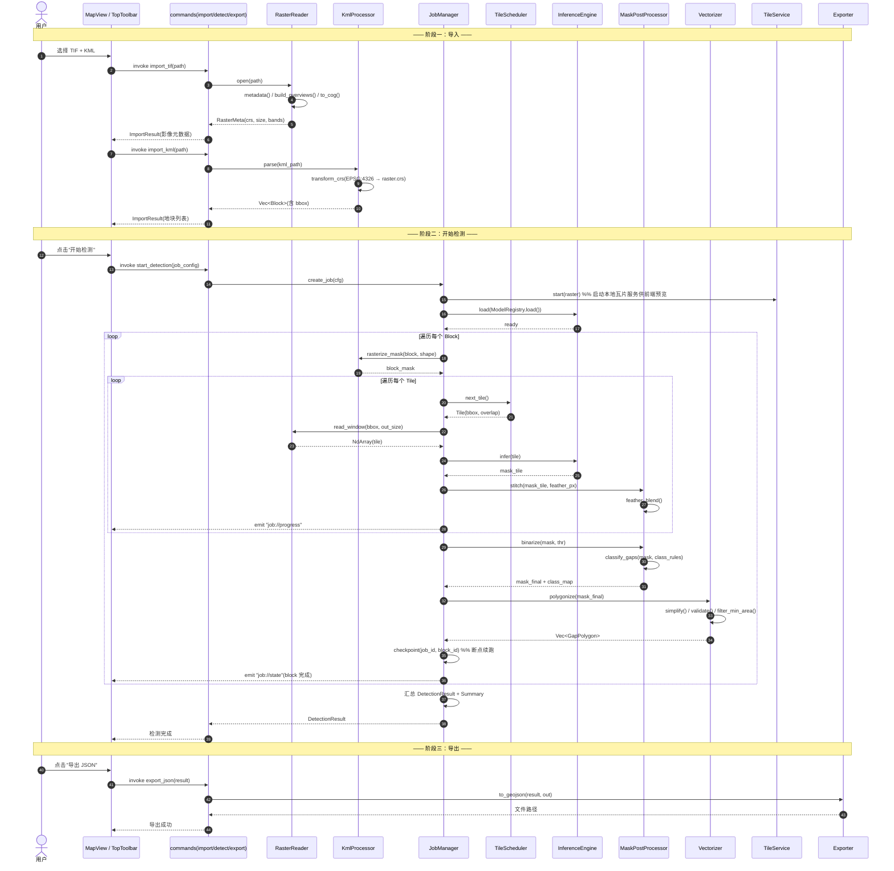
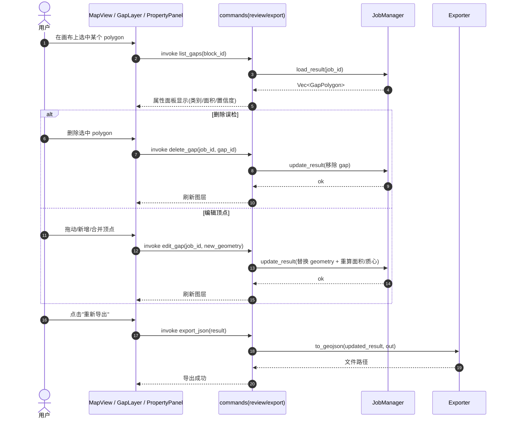
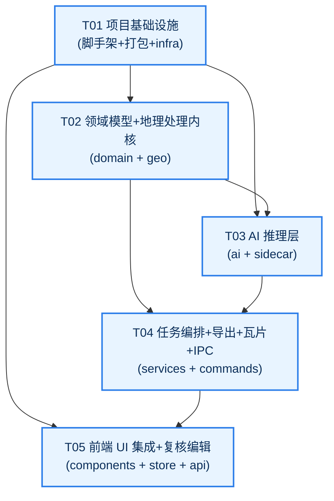
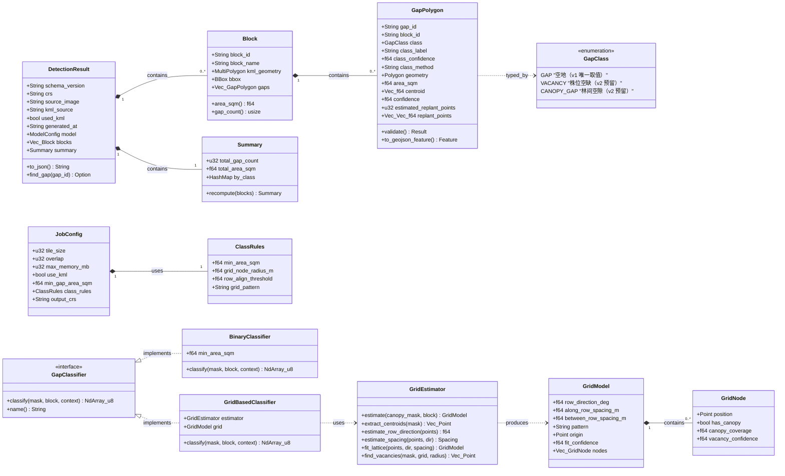
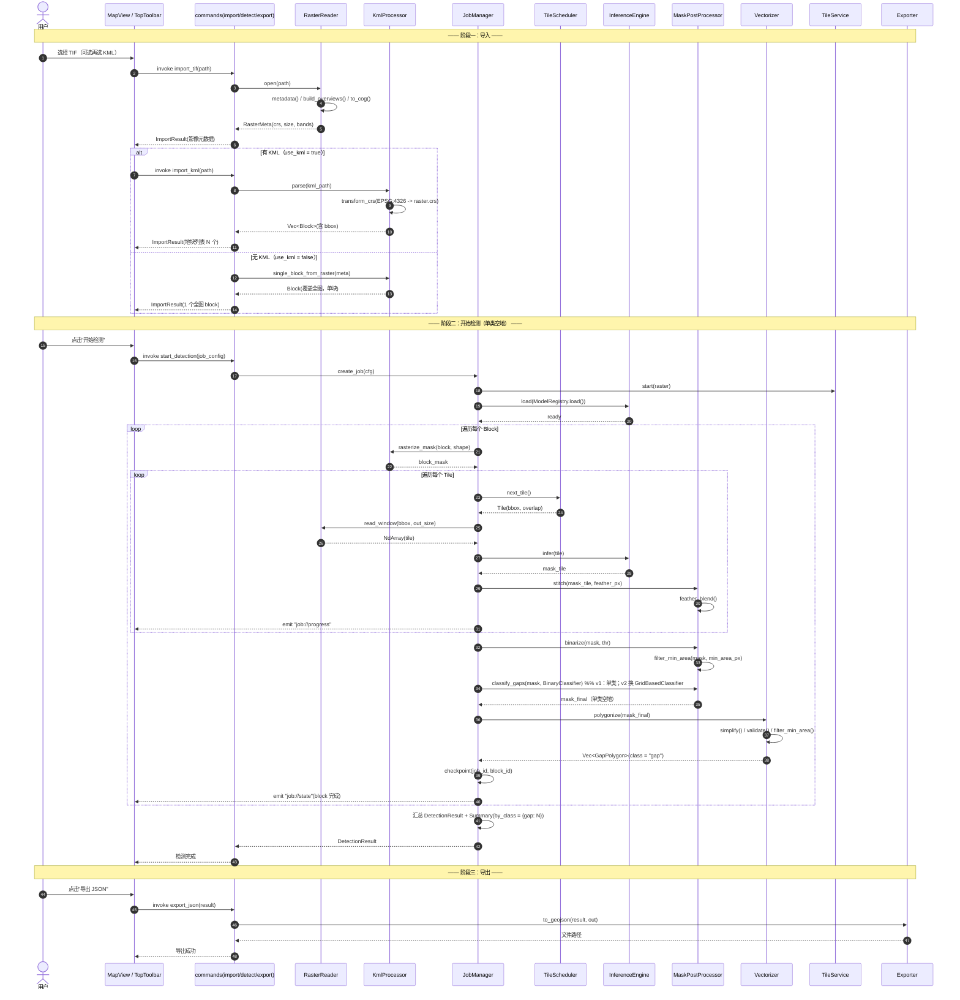
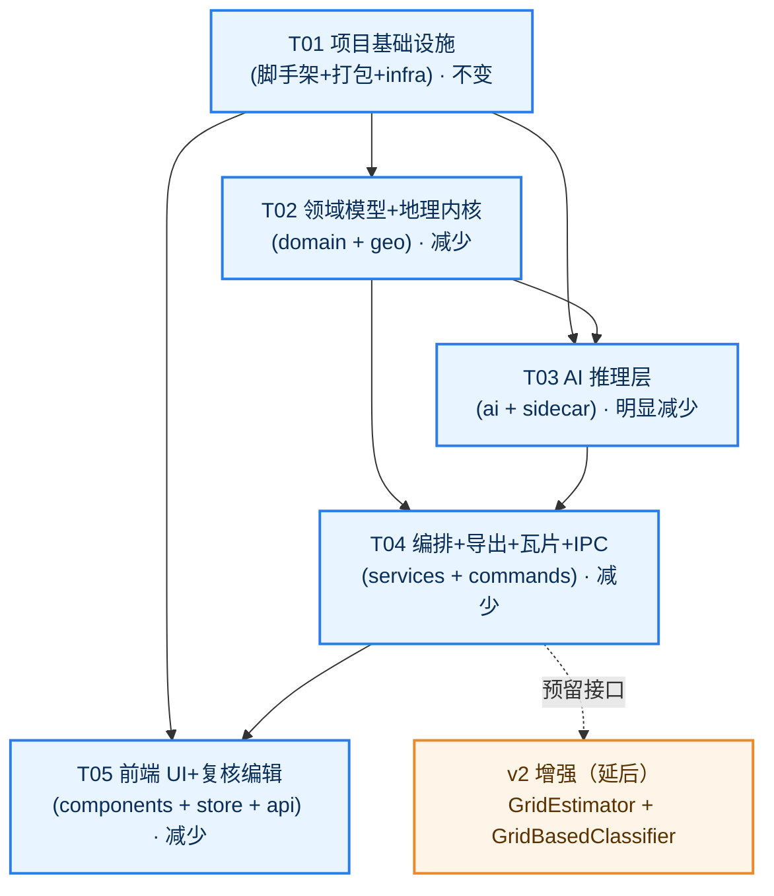

# 油棕园空地智能检测系统 — 系统架构设计 + 任务分解

> 项目代号：`forest_gap_detection`  
> 文档版本：v0.1（对应 PRD v0.1）  
> 目标平台：Windows 桌面优先（Tauri v2），架构预留 macOS / Linux  
> 阶段定位：**可行性 + 架构理解阶段（零代码起步，暂不落地实现）**

---

## 阅读指引

- **非技术读者**：只需读 **A1 的核心难点拆解 + 三张取舍表 + 分叉式设计**，即可理解"为什么这么选、风险在哪、怎么兜底"。
- **工程读者**：A2 文件列表、A3 类图、A4 时序图、B1~B4 任务分解是可直接进入开发的施工图。
- **决策者**：重点看三张取舍表的"推荐结论"列、分叉式设计的两条路线差异表、B2 任务列表的优先级。

---

# Part A：系统设计

## A1. 实现方案与选型

### A1.1 核心难点拆解

本系统的本质是：**在普通 Windows 工作站上，把一块约 3GB 的无人机正射影像（DOM）吃进去，按 KML 圈定的地块，用 AI 找出"没有油棕树冠"的区域并切成合规多边形，最后吐出可下发种植队的补种成果。** 难点集中在以下 6 处：

| 编号 | 难点                        | 本质问题                                                                                                                                    | 解决思路                                                                                                                                                           |
| -- | ------------------------- | --------------------------------------------------------------------------------------------------------------------------------------- | -------------------------------------------------------------------------------------------------------------------------------------------------------------- |
| D1 | **超大栅格 IO**               | 3GB TIF 不能整幅读入内存，否则必 OOM                                                                                                                | 分块（tile）+ 窗口化读取（`GDAL ReadWindow`）+ 金字塔概览（overview）+ 转 COG；峰值内存硬上限可配（默认 4GB）                                                                                   |
| D2 | **分块推理的边界拼接**             | 相邻分块各自推理，接缝处会出现"割裂的树冠/空隙"伪影，导致同一空地裂成多块或漏检                                                                                               | 分块带 **overlap（重叠边，如 64~128px）**；输出 mask 在重叠区做 **羽化加权融合（feather blending）**，再统一二值化                                                                              |
| D3 | **mask → polygon 矢量化与简化** | 栅格 mask 转矢量后会产生大量锯齿、碎片、自相交，不合规                                                                                                          | `GDAL Polygonize` 转矢量 → 面积/孔洞过滤 → Douglas-Peucker 简化 + 拓扑修复（`geo` 库）→ 合法性校验（无自相交、闭合）                                                                           |
| D4 | **三类空地判定策略**              | **"空地 = 树冠掩膜的补集"**：先分割出油棕树冠 mask，取补集即得空地；A 类长期闲置 / B 类枯死缺株 / C 类林间空隙 本质是同一张无树冠 mask 上的形态学+几何差异。**单期 RGB 无法可靠区分 idle 与 hole**，v1 只能做几何分类 | **规则引擎 + 置信度**：基于 polygon 的**面积、长宽比、连通分量数、与树冠的邻接关系、成排性（Hough/主方向）** 判定类别；输出 `class_confidence` + `class_method` 标注判定来源；UI 标记为"候选类别，需人工复核"。规则阈值全部可配置，后续可替换为分类模型 |
| D5 | **CRS 处理**                | KML 是 WGS84（EPSG:4326，经纬度），影像通常是投影坐标系（如 EPSG:32648 UTM 48N，米）                                                                           | 导入 KML 时用 `proj` 做 4326 → 影像 CRS 坐标变换；所有面积计算在**投影坐标系（米）**&#x4E0B;进行；导出 GeoJSON 提供 CRS 选项                                                                       |
| D6 | **桌面端渲染 3GB 大图**          | 一次性把 3GB 影像丢给前端 Canvas/浏览器必崩                                                                                                            | 后端 `GDAL` 生成 **本地 XYZ 瓦片**，用轻量 HTTP 服务（axum）供前端 **MapLibre GL / deck.gl（WebGL）** 按需加载；多边形作为独立矢量图层叠加                                                            |

> **核心处理链（贯穿 D3~D5）**：`树冠分割 mask → 取补集得到空地 mask → 栅格转矢量（Polygonize）→ 简化/平滑 → 面积过滤 → 三类打标 → 合规 GeoJSON`。这条 GIS 后处理链是本系统的心脏，且必须满足 PRD R-P0-4 &#x7684;**"无自相交 GeoJSON"硬约束**（见 A1.2 表 2 与 B3 约定）。

### A1.2 关键取舍对比（3 组）

#### 表 1：推理执行方式 —— Python sidecar vs 纯 Rust(ort)

| 对比维度          | Python sidecar（PyInstaller/FastAPI 随应用分发） |     纯 Rust（`ort` = ONNX Runtime 绑定）    | 说明                       |
| ------------- | :---------------------------------------: | :------------------------------------: | ------------------------ |
| **包体大小**      |       ❌ 大（PyTorch+SAM2+依赖常 1.5~3GB+）      | ✅ 小（ort runtime + onnx 权重，约 100~400MB） | 3GB 影像场景下包体不是首要矛盾，但仍影响分发 |
| **GPU 支持成熟度** |      ✅ 极成熟（CUDA/TensorRT/torch 生态完善）      |   ⚠️ 可用但较窄（ort CUDA/TensorRT EP，踩坑多）   | 若有 GPU，Python 更省心        |
| **开发效率**      |   ✅ 高（DeepForest / SAM2 / ForestSAM 现成）   |          ❌ 低（预处理/后处理/模型转换需重写）          | 学术成果几乎全是 Python          |
| **算法生态**      |               ✅ 遥感/深度学习生态最全               |                  ⚠️ 有限                 | 换模型/换算法成本差异大             |
| **跨平台打包难度**   |            ❌ 高（CUDA 依赖、dll 地狱）            |                ✅ 低（单二进制）               | 影响后续 macOS/Linux 预留      |
| **调试成本**      |            ✅ 低（Python 交互式、日志友好）           |               ❌ 高（编译+绑定层）              | —                        |
| **冷启动**       |              ⚠️ 较慢（解释器+模型加载）              |                   ✅ 快                  | 可用常驻进程缓解                 |

> **推荐结论：以 Python sidecar 为默认推理后端，Rust `ort` 作为可选轻量/离线降级后端。**  
> 理由：算法落地依赖学术成果（DeepForest/ForestSAM），Python 生态不可替代；同时用 `InferenceEngine` trait 抽象，把"跑在哪"与"跑什么"解耦——Rust 侧只负责调度与地理处理，推理进程可换。这样既拿到 Python 的开发效率，又保留 Rust 的性能与跨平台余地。  
> **模型以 ONNX 分发**（PyTorch 仅用于训练/导出，不随应用打包）——这是控制安装包体积的关键：纯 ONNX Runtime CPU 仅几十 MB，而含 PyTorch+CUDA 的包常达 1.5~3GB。

#### 表 2：影像渲染方案 —— WebGL 瓦片服务 vs Canvas 直接绘制 vs 桌面 GIS 嵌入

| 对比维度               | WebGL 瓦片服务（MapLibre/deck.gl + 本地瓦片） |     Canvas 直接绘制    | 桌面 GIS 嵌入（QGIS/ArcGIS 组件） |
| ------------------ | :---------------------------------: | :----------------: | :-----------------------: |
| **3GB 影像渲染可行性**    |          ✅ 可行（按需加载，视口内才解码）          | ❌ 不可行（整幅解码必爆内存/极卡） |            ✅ 可行           |
| **交互体验（缩放/平移/叠加）** |          ✅ 好（GPU 加速、矢量叠加顺滑）         |        ⚠️ 差        |            ✅ 好            |
| **实现成本**           |          ⚠️ 中（需瓦片服务 + 前端集成）         |      ✅ 低（但不可用）     |      ❌ 高（组件重、授权/耦合重）      |
| **打包/分发**          |            ✅ 轻（纯 Web 技术）            |         ✅ 轻        |        ❌ 重（原生依赖巨大）        |
| **与 Tauri 契合度**    |           ✅ 高（前端即 WebView）          |         ✅ 高        |            ❌ 低            |
| **多图层/样式灵活性**      |        ✅ 高（GeoJSON 图层、样式表达式）        |        ⚠️ 低        |            ✅ 高            |

> **推荐结论：采用「后端本地瓦片服务 + 前端 WebGL 渲染」。**  
> 理由：Tauri 前端本就是 WebView，MapLibre GL 是最自然的搭档；后端用 GDAL 生成 XYZ 瓦片（复用 `gdal2tiles` 思路或自实现），既解决 3GB 渲染，又能把 polygon 作为独立矢量图层做选中/删除/编辑。Canvas 方案在 3GB 下直接出局；桌面 GIS 嵌入与 Tauri 技术栈冲突、分发成本过高。

#### 表 3：模型路线 —— 开源预训练迁移/微调 vs 自研训练

| 对比维度        |                  开源预训练迁移/微调（DeepForest/ForestSAM）                 |       自研从零训练       |
| ----------- | :---------------------------------------------------------------: | :----------------: |
| **所需数据量**   |                         ✅ 中（数百张标注影像块即可微调）                         |  ❌ 大（数千张 + 高质量标注）  |
| **GPU 条件**  |                             ✅ 单卡消费级可微调                            |      ❌ 需较强算力集群     |
| **周期**      |                                ✅ 短                                |         ❌ 长        |
| **精度预期**    | ✅ 高（已有油棕树冠成果：ForestSAM Dice 0.826 / IoU 0.712；YOLO 方案 mAP 98.83%） |       ⚠️ 不确定       |
| **风险**      |                                ✅ 低                                | ❌ 高（数据、算力、调参三重不确定） |
| **可控性/私有化** |                           ⚠️ 中（依赖开源权重许可）                          |         ✅ 高        |

> **推荐结论：以「开源预训练迁移/微调」为默认路线，自研训练仅作为长期演进选项。**  
> 理由：油棕树冠检测已有成熟学术落地，从零训练在数据、算力、周期上都不划算。先用预训练权重跑通端到端流程，再用本地标注数据做领域微调（domain fine-tune）提升精度，是风险最低的路径。

### A1.3 分叉式设计（针对 PRD 待确认问题 1/2/3/7）

PRD 尚有关键未知：**是否已有模型、是否有标注数据、是否有 GPU、是否必须纯离线**。本架构用"两条路线 + 单一切换点"兜住：

| 待确认问题      | 路线 α（乐观）          | 路线 β（保守）                 |
| ---------- | ----------------- | ------------------------ |
| ① 是否已有模型权重 | 有（或可下载）→ 直接用      | 无 → 内置默认权重 + 支持手动导入/联网下载 |
| ② 是否有标注数据  | 有 → 直接微调          | 无 → 先用预训练零样本/少样本，后续补标注   |
| ③ 是否有 GPU  | 有 → CUDA 推理       | 无 → CPU（ort）推理，降低分块并发    |
| ⑦ 是否必须纯离线  | 可联网 → 允许模型下载/云端推理 | 纯离线 → 全本地，权重随包内置         |

**两条路线在架构上的差异点，被严格收敛到以下 3 处（其余模块完全不变）：**

```
差异集中区（仅此三处）：
┌─────────────────────────────────────────────────────────────┐
│  1. InferenceEngine 的实现选择                                │
│     α → PythonSidecarEngine（onnxruntime-gpu / torch CUDA）   │
│     β → OrtEngine（Rust ort，CPU/onnx）                       │
│     （二者同实现 InferenceEngine trait，上层无感）             │
│                                                             │
│  2. ModelRegistry 的后端                                      │
│     α → 本地模型目录 + 可选云端下载源                          │
│     β → 仅内置默认权重（随安装包分发）                          │
│                                                             │
│  3. ModelConfig 中的 device / provider 字段                   │
│     α → device="cuda", provider="CUDAExecutionProvider"       │
│     β → device="cpu",  provider="CPUExecutionProvider"        │
└─────────────────────────────────────────────────────────────┘

完全不变区（两条路线共用）：
  RasterReader · TileScheduler · MaskPostProcessor · Vectorizer
  KmlProcessor · JobManager · Exporter · TileService · 前端全部 UI
```

> **工程含义**：切换 α/β 只需改一行配置 + 部署对应引擎，**不需要改任何地理处理、任务编排或前端代码**。这保证了在关键问题澄清前，架构即可冻结、开发即可并行推进。

---

## A2. 文件列表

> 说明：本阶段为可行性/架构理解，以下为**规划文件树**（尚未创建代码）。

```
forest_gap_detection/
├─ package.json                     # 前端依赖与脚本入口
├─ pnpm-lock.yaml                   # 依赖锁定
├─ vite.config.ts                   # Vite 构建配置（含 Tauri 适配）
├─ tsconfig.json / tsconfig.node.json  # TS 编译配置
├─ tailwind.config.ts / postcss.config.js  # Tailwind 样式管线
├─ index.html                       # WebView 入口 HTML
│
├─ src/                             # ── 前端（React + TypeScript + MapLibre GL）
│  ├─ main.tsx                      # React 挂载入口
│  ├─ App.tsx                       # 三栏 GIS 布局根组件
│  ├─ styles/global.css             # 全局样式 + Tailwind 指令
│  ├─ types/
│  │  ├─ models.ts                  # 前端类型（镜像 Rust 领域模型）
│  │  ├─ ipc.ts                     # IPC 命令/事件载荷类型
│  │  └─ geojson.ts                 # GeoJSON 类型定义
│  ├─ store/
│  │  ├─ useJobStore.ts             # 任务/进度状态（zustand）
│  │  └─ useLayerStore.ts           # 图层/选中多边形状态
│  ├─ api/
│  │  ├─ tauriClient.ts             # invoke 封装（命令调用统一出口）
│  │  └─ events.ts                  # 监听后端进度/日志/状态事件
│  ├─ components/
│  │  ├─ TopToolbar.tsx             # 导入/检测/暂停/续跑/导出/设置
│  │  ├─ LeftPanel/
│  │  │  ├─ JobList.tsx             # 任务列表 + 地块切换
│  │  │  └─ LayerControl.tsx        # 图层显隐/类别过滤
│  │  ├─ MapCanvas/
│  │  │  ├─ MapView.tsx             # MapLibre GL 画布（影像瓦片底图）
│  │  │  ├─ GapLayer.tsx            # polygon 叠加 + 选中/删除/编辑
│  │  │  └─ tileUrl.ts              # 本地瓦片 URL 组装
│  │  ├─ RightPanel/
│  │  │  ├─ PropertyPanel.tsx       # 属性面板容器
│  │  │  └─ GapAttributes.tsx       # 单空地属性（类别/面积/置信度）
│  │  └─ StatusBar/
│  │     ├─ ProgressBar.tsx         # 全流程进度条
│  │     └─ LogConsole.tsx          # 可导出日志
│  └─ hooks/
│     ├─ useDetectionProgress.ts    # 进度事件订阅
│     └─ useTauriEvent.ts           # 通用事件订阅 hook
│
├─ src-tauri/                       # ── Rust 后端（Tauri v2）
│  ├─ Cargo.toml                    # Rust 依赖清单
│  ├─ tauri.conf.json               # Tauri 应用配置（含 sidecar 声明）
│  ├─ build.rs                      # 构建脚本
│  ├─ capabilities/default.json     # 权限能力声明（dialog/fs/shell）
│  ├─ icons/                        # 应用图标
│  ├─ binaries/
│  │  └─ infer_sidecar(.exe)        # Python 推理 sidecar（构建产物放置处）
│  └─ src/
│     ├─ main.rs                    # 进程入口
│     ├─ lib.rs                     # 应用装配（注册命令/状态/插件）
│     ├─ commands/                  # IPC 命令层（前端唯一入口）
│     │  ├─ mod.rs
│     │  ├─ import.rs               # import_tif / import_kml
│     │  ├─ detect.rs               # start_detection / pause / resume
│     │  ├─ review.rs               # list_gaps / delete_gap / edit_gap
│     │  ├─ export.rs               # export_json / export_csv / export_kml
│     │  └─ config.rs               # get_config / set_config
│     ├─ geo/                       # ── 地理处理内核
│     │  ├─ mod.rs
│     │  ├─ raster_reader.rs        # RasterReader：GDAL 窗口化读取/概览/COG
│     │  ├─ tile_scheduler.rs       # TileScheduler：分块 + overlap 规划
│     │  ├─ kml_processor.rs        # KmlProcessor：KML 解析 + CRS 转换 + 栅格化
│     │  ├─ vectorizer.rs           # Vectorizer：mask→polygon + 简化 + 校验
│     │  └─ crs.rs                  # CRS 工具（proj 封装）
│     ├─ ai/                        # ── AI 推理层（分叉式双引擎）
│     │  ├─ mod.rs
│     │  ├─ inference_engine.rs     # InferenceEngine trait（引擎抽象）
│     │  ├─ sidecar_engine.rs       # PythonSidecarEngine（路线 α）
│     │  ├─ ort_engine.rs           # OrtEngine（路线 β）
│     │  ├─ mask_postprocessor.rs   # MaskPostProcessor：拼接/羽化/二值化/分类
│     │  └─ model_registry.rs       # ModelRegistry：模型发现/加载/导入
│     ├─ domain/                    # ── 领域数据模型
│     │  ├─ mod.rs
│     │  ├─ gap.rs                  # GapPolygon / GapClass
│     │  ├─ block.rs                # Block
│     │  ├─ result.rs               # DetectionResult / Summary
│     │  ├─ job.rs                  # TaskJob / JobState
│     │  └─ model_config.rs         # ModelConfig
│     ├─ services/                  # ── 服务层
│     │  ├─ mod.rs
│     │  ├─ job_manager.rs          # JobManager：任务队列 + 断点续跑
│     │  ├─ exporter.rs             # Exporter：JSON/CSV/KML 导出
│     │  └─ tile_service.rs         # TileService：本地 XYZ 瓦片 HTTP 服务
│     └─ infra/                     # ── 基础设施
│        ├─ mod.rs
│        ├─ config.rs               # 配置（内存上限等）
│        ├─ error.rs                # 错误码定义
│        └─ logging.rs              # 日志格式约定
│
├─ sidecar/                         # ── Python 推理服务
│  ├─ pyproject.toml                # Python 项目元数据
│  ├─ requirements.txt              # Python 依赖
│  ├─ infer_server.py               # 入口（CLI / FastAPI 二选一）
│  ├─ build_sidecar.py              # PyInstaller 打包脚本
│  ├─ models/
│  │  ├─ palm_canopy_seg.onnx       # 默认模型权重（路线 β 内置）
│  │  └─ model_card.json            # 模型元信息
│  └─ src/
│     ├─ engine.py                  # 推理封装（torch/onnx）
│     ├─ preprocess.py              # 归一化/通道处理
│     ├─ postprocess.py             # 掩膜后处理
│     └─ classifier.py              # A/B/C 三类判定规则
│
├─ scripts/
│  ├─ build_sidecar.ps1             # Windows 下 sidecar 构建脚本
│  └─ fetch_models.py               # 模型下载/校验脚本
│
└─ docs/
   ├─ PRD.md                        # 产品需求文档
   ├─ system_design.md              # 本文档
   ├─ sequence-diagram.mermaid      # 时序图（独立文件）
   └─ class-diagram.mermaid         # 类图（独立文件）
```


## A4. 程序调用流程（时序图）

> 完整可渲染源码见 `docs/sequence-diagram.mermaid`。

### A4.1 主流程：导入 TIF + KML → 检测 → 矢量化 → 导出 JSON



### A4.2 复核流程：人工复核编辑 polygon → 重新导出



---

## A5. 待明确事项（含假设）

> 以下均来自 PRD 第 6 节的 14 个待确认问题。凡未获明确答复的，本设计按"**假设**"推进，并已用分叉式设计兜住。

| 编号  | 事项                                    | 本设计的假设                                                       | 若假设不成立的影响                      |
| --- | ------------------------------------- | ------------------------------------------------------------ | ------------------------------ |
| Q1  | 是否已有模型权重                              | **假设**：初期无，先内置开源预训练（DeepForest/ForestSAM 转换的 ONNX）           | 有则直接接入，仅改 `ModelRegistry`      |
| Q2  | 是否有标注数据                               | **假设**：暂无，先零样本/少样本跑通                                         | 有则加入微调环节，不影响架构                 |
| Q3  | 是否有 GPU 环境                            | **假设**：终端以 CPU 为主，GPU 为可选加速                                  | 有则切 `device="cuda"`，仅改配置       |
| Q4  | 最小面积阈值 / 三类判定标准                       | **假设**：全部走可配置 `ClassRules`（默认 idle≥2000㎡、hole≤200㎡、gap≤200㎡） | 由业务方给数值，改配置即可                  |
| Q5  | 补种株数与布点规格（株行距）                        | **假设**：按 9m×9m 标准株行距估算补种点数                                   | 改为可配置参数                        |
| Q6  | 精度验收指标                                | **假设**：以 IoU/Dice ≥ 0.70、面积误差 ≤ 10% 为初版目标                    | 需与业务方确认后再定验收线                  |
| Q7  | 是否必须纯离线                               | **假设**：默认纯离线（数据敏感），联网能力作为可选                                  | 见 A1.3 分叉式设计 α/β               |
| Q8  | 3GB 全流程耗时上限                           | **假设**：可接受"小时级"，CPU 亦可用                                      | 若要求分钟级，需强制 GPU + 分块并发          |
| Q9  | 园区 CRS / KML 坐标转换                     | **假设**：KML 为 WGS84；影像 CRS 从 TIF 自动读取；输出默认 EPSG:4326          | 由业务方提供 CRS 后写死为默认              |
| Q10 | 是否需对接 ArcGIS/QGIS / 是否需 Shapefile/KML | **假设**：JSON 为主，CSV/KML 为 P1 附加                               | 若需 Shapefile，`Exporter` 增加一个方法 |
| Q11 | 单机还是多机/团队协作                           | **假设**：单机桌面应用，无服务端                                           | 多机需引入任务同步，架构需扩展                |
| Q12 | 平台范围                                  | **假设**：仅 Windows 优先，架构预留 macOS/Linux                         | 预留已做，落地时补打包                    |
| Q13 | TIF 规格（波段/位深/地理坐标/分幅）                 | **假设**：RGB 8bit、含地理坐标、单文件正射                                  | 多光谱需调整 `preprocess` 通道处理       |
| Q14 | KML 结构（单地块/多地块/层级）                    | **假设**：单 KML 含 N≥10 地块，`Placemark` 平铺或一层嵌套                   | 深层级需扩展 `KmlProcessor.parse`    |


**其他假设**：

- **假设**：用户机器可写本地临时目录，用于存放 COG/瓦片/中间态（默认 `%LOCALAPPDATA%/forest_gap_detection/`）。
- **假设**：多边形坐标统一在**影像投影 CRS（米）**&#x4E0B;计算面积/质心，导出时再按 `output_crs` 转换。
- **假设**：单次任务处理单个 TIF；**架构预留多影像输入接口**（`TileScheduler`/`InferenceEngine` 以影像列表为输入），多影像/多期对比（R-P2-2）与多光谱为后续演进。

---

# Part B：任务分解

## B1. 所需依赖包

### Rust crates（`src-tauri/Cargo.toml`）

```
- tauri@^2.0               : 桌面应用框架（WebView + IPC + sidecar）
- tauri-plugin-dialog@^2   : 文件选择对话框
- tauri-plugin-fs@^2       : 本地文件读写
- tauri-plugin-shell@^2    : 调用 sidecar 外部进程
- gdal@^0.17               : GDAL 绑定（窗口化读取/COG/polygonize/重投影）
- proj@^0.27               : CRS 坐标变换（EPSG:4326 ↔ 影像 CRS）
- geo@^0.28 / geo-types    : 几何运算、简化、拓扑校验
- geojson@^0.24            : GeoJSON 序列化
- ort@^2.0                 : ONNX Runtime 绑定（路线 β 推理）
- ndarray@^0.16            : 多维数组（分块/mask 运算）
- image@^0.25 / imageproc  : 图像处理辅助
- axum@^0.7 / tower-http   : 本地 XYZ 瓦片 HTTP 服务
- tokio@^1                 : 异步运行时（任务编排/瓦片服务）
- rayon@^1                 : 数据并行（分块并发）
- quick-xml@^0.36          : KML/XML 解析
- serde@^1 / serde_json@^1 : 序列化（IPC + JSON 输出）
- anyhow@^1 / thiserror@^1 : 错误处理
- tracing@^0.1 / tracing-subscriber : 结构化日志
- chrono@^0.4              : 时间戳（ISO 8601）
- uuid@^1                  : job_id / gap_id 生成
```

### npm 包（`package.json`）

```
- react@^18.2 / react-dom@^18.2      : UI 框架
- @tauri-apps/api@^2.0               : 前端 IPC 客户端
- @tauri-apps/plugin-dialog@^2       : 对话框前端封装
- @tauri-apps/plugin-fs@^2           : 文件读写前端封装
- maplibre-gl@^4.0                   : WebGL 影像画布 + 矢量叠加
- deck.gl@^9.0 (可选)                : 复杂矢量图层（如需要）
- zustand@^4.5                       : 轻量状态管理
- tailwindcss@^3.4                   : 原子化样式
- typescript@^5.4                    : 类型系统
- vite@^5.2 / @vitejs/plugin-react@^4: 构建工具
- @tanstack/react-query@^5 (可选)    : 异步状态/轮询
```

### Python 包（`sidecar/requirements.txt`）

```
- onnxruntime / onnxruntime-gpu     : ONNX 推理运行时（分发主用；CPU 版仅几十 MB）
- torch / torchvision               : 仅用于训练/导出 ONNX，不随应用分发（含 CUDA 版本）
- numpy                             : 数值计算
- opencv-python-headless            : 图像预处理
- rasterio / GDAL                   : 栅格读写（Python 侧辅助）
- shapely                           : 几何处理（分类规则辅助）
- fastapi / uvicorn                 : 常驻服务模式（可选，替代 CLI）
- pyinstaller                       : 打包为单文件 sidecar
```

### 外部二进制

```
- GDAL CLI（gdal_translate / gdalwarp / gdaladdo）: 随应用捆绑（参考 tauri-gdal-template）
- Python Runtime（PyInstaller 产物）              : 随 sidecar 分发
- ONNX Runtime（CUDA 版，可选）                    : 路线 α GPU 推理
```

---

## B2. 任务列表（≤ 5 个任务，按依赖顺序）

> 原则：按**功能层次**分组，不按单文件拆分；配置文件全部集中在 T01；任务间尽量只依赖 T01，减少线性链。

| Task ID | 任务名称                                            | 涉及文件                                                                                                                                                                                                                                                                                                                                                                         |    依赖    | 优先级 |
| ------- | ----------------------------------------------- | ---------------------------------------------------------------------------------------------------------------------------------------------------------------------------------------------------------------------------------------------------------------------------------------------------------------------------------------------------------------------------- | :------: | :-: |
| **T01** | **项目基础设施**（脚手架 + 打包配置 + 基础设施层）                  | `package.json`、`vite.config.ts`、`tsconfig*.json`、`tailwind.config.ts`、`postcss.config.js`、`index.html`、`src/main.tsx`、`src/App.tsx`、`src/styles/global.css`、`src-tauri/Cargo.toml`、`src-tauri/tauri.conf.json`、`src-tauri/build.rs`、`src-tauri/capabilities/default.json`、`src-tauri/src/main.rs`、`src-tauri/src/lib.rs`、`src-tauri/src/infra/{mod,config,error,logging}.rs` |     —    |  P0 |
| **T02** | **领域模型 + 地理处理内核**（数据模型 + 栅格/矢量/CRS/KML）         | `src-tauri/src/domain/{mod,gap,block,result,job,model_config}.rs`、`src-tauri/src/geo/{mod,raster_reader,tile_scheduler,kml_processor,vectorizer,crs}.rs`、`src/types/{models,geojson}.ts`                                                                                                                                                                                     |    T01   |  P0 |
| **T03** | **AI 推理层**（双引擎分叉 + 后处理 + 模型注册 + Python sidecar） | `src-tauri/src/ai/{mod,inference_engine,sidecar_engine,ort_engine,mask_postprocessor,model_registry}.rs`、`sidecar/pyproject.toml`、`sidecar/requirements.txt`、`sidecar/infer_server.py`、`sidecar/build_sidecar.py`、`sidecar/src/{engine,preprocess,postprocess,classifier}.py`、`sidecar/models/model_card.json`、`scripts/build_sidecar.ps1`、`scripts/fetch_models.py`         | T01, T02 |  P0 |
| **T04** | **任务编排 + 导出 + 瓦片服务 + IPC 命令**（服务层与命令层）          | `src-tauri/src/services/{mod,job_manager,exporter,tile_service}.rs`、`src-tauri/src/commands/{mod,import,detect,review,export,config}.rs`                                                                                                                                                                                                                                     | T02, T03 |  P0 |
| **T05** | **前端 UI 集成 + 复核编辑**（三栏布局 + 地图 + 交互）             | `src/components/**`（TopToolbar、LeftPanel/*、MapCanvas/*、RightPanel/*、StatusBar/*）、`src/store/{useJobStore,useLayerStore}.ts`、`src/api/{tauriClient,events}.ts`、`src/hooks/{useDetectionProgress,useTauriEvent}.ts`、`src/types/ipc.ts`                                                                                                                                         | T01, T04 |  P0 |

**工作量阶段表述**（不写具体天数）：

- **阶段一（T01）**：脚手架打通——Tauri + React + MUI/Tailwind 能起窗、能 IPC 通信、能打包。
- **阶段二（T02）**：地理内核——能用 GDAL 读 3GB TIF 的分块、能解析 KML 并转 CRS、能 mask→polygon。
- **阶段三（T03）**：AI 接入——sidecar 能跑通一次端到端推理，双引擎可切换。
- **阶段四（T04）**：编排闭环——能创建任务、断点续跑、导出合规 JSON。
- **阶段五（T05）**：可视化闭环——能在 WebGL 画布上看到影像与 polygon、能复核编辑。

> 注：T02/T03 可并行（T03 依赖 T02 的数据模型，但可先基于接口契约开发）；T05 在 T04 命令契约冻结后即可并行推进 UI。

---

## B3. 共享知识（跨文件约定）

### 1. JSON Schema 与版本

- `DetectionResult.schema_version` 固定为字符串 `"0.1"`，任何结构变更必须递增并在 `Exporter` 中做兼容分支。
- JSON 字段命名统一 **snake_case**（与 PRD 草案一致）。
- **gap 对象扩展字段**（相对 PRD 草案新增）：`class_confidence`(f64) 与 `class_method`(String，取值 `geometry_rule` | `spectral` | `model`)——标明类别判定来源，供 UI 显示为"候选类别，需人工复核"。
- **空地定义**：空地 = 树冠掩膜的**补集**；处理链固定为 `树冠 mask → 补集 → Polygonize → 简化 → 面积过滤 → 打标`。
- **模型插件化**：`ModelConfig` 携带 `input_size` / `normalization` / `class_mapping` / `conf_threshold`，实现 R-P1-3「换权重不改代码」。

### 2. CRS 统一策略

- **计算坐标系**：所有面积、质心、距离计算统一在**影像投影 CRS（单位：米）**&#x4E0B;进行。
- **KML 输入**：默认 EPSG:4326，导入时经 `KmlProcessor.transform_crs` 转到影像 CRS。
- **输出坐标系**：GeoJSON 默认 EPSG:4326（遵循 RFC 7946），并在顶层 `crs` 字段记录影像原始 CRS；`output_crs` 可配置。
- 禁止在经纬度下直接算面积（`area_sqm` 一律由投影坐标计算）。

### 3. 错误码规范（`infra/error.rs`）

```
E1xxx : IO / 文件（打开失败、格式不支持、磁盘满）
E2xxx : CRS / 坐标变换（无 CRS、投影失败、越界）
E3xxx : 推理（模型加载失败、sidecar 崩溃、显存不足）
E4xxx : 矢量化（几何非法、自相交、简化失败）
E5xxx : 导出（路径不可写、序列化失败）
E9xxx : 未知 / 内部错误
```

- 所有命令返回统一结构 `{ code, data, message }`（code=0 表示成功）。

### 4. 日志格式（`infra/logging.rs`）

- 控制台：`[ISO8601][LEVEL][module] message`
- 文件：JSON Lines（每行一个 JSON 对象），便于导出与解析。
- 日志落盘路径：`%LOCALAPPDATA%/forest_gap_detection/logs/`。

### 5. 内存与性能配置键（`infra/config.rs`）

```
processing.max_memory_mb   : 默认 4096   # 峰值内存硬上限
processing.tile_size       : 默认 1024   # 分块边长(px)
processing.overlap         : 默认 128    # 分块重叠(px)
processing.concurrency     : 默认 =CPU核数/2
processing.min_gap_area_sqm: 默认 50
output.output_crs          : 默认 EPSG:4326
```

### 6. IPC 事件约定

```
命令（前端→后端）: invoke("import_tif"|"import_kml"|"start_detection"|"pause_detection"|
                          "resume_detection"|"list_gaps"|"delete_gap"|"edit_gap"|
                          "export_json"|"export_csv"|"get_config"|"set_config", payload)
事件（后端→前端）: "job://progress" { job_id, percent, stage }
                  "job://log"      { job_id, level, message }
                  "job://state"    { job_id, state, block_id? }
```

### 7. 瓦片与中间态

- 瓦片命名：`{z}/{x}/{y}.png`，由 `TileService` 提供本地 HTTP 服务（仅监听 `127.0.0.1`）。
- 中间态（断点续跑）按 `job_id/block_id` 存储于本地缓存目录，采用 COG 或 `.npy` 掩膜快照。

### 8. 三类空地判定（`ClassRules` 默认值，全部可配）

```
A 类 idle : 面积 ≥ 2000㎡ 且 连通、长宽比接近 1、非成排
B 类 hole : 面积 ≤ 200㎡ 且 成排/簇状、靠近树冠边界
C 类 gap  : 面积 ≤ 200㎡ 且 零散分布于树冠间隙、形态不规则
```

> 具体阈值待业务方确认（见 A5-Q4），代码中一律从配置读取，禁止硬编码。

---

## B4. 任务依赖图



> 关键路径：**T01 → T02 → T03 → T04 → T05**。  
> 并行机会：T03（在 T02 接口冻结后）与 T05（在 T04 命令契约冻结后）均可与上游并行开发。

---

## 附录：三条推荐结论速览

1. **推理**：Python sidecar 为主 + Rust `ort` 为可选降级，通过 `InferenceEngine` trait 解耦（详见 A1.2 表 1、A1.3）。
2. **渲染**：后端本地 XYZ 瓦片服务 + 前端 MapLibre GL（WebGL）渲染（详见 A1.2 表 2）。
3. **模型**：开源预训练迁移/微调优先，自研训练作为长期选项（详见 A1.2 表 3）。

> 上述三条 + 分叉式设计（α/β）共同保证：**在 PRD 关键未知澄清之前，架构即可冻结、开发即可并行推进。**

---

---

# 附录 A：增量设计 v0.2（需求收敛后）

> 触发原因：用户澄清需求，需求**收敛**（不是扩张）。核心变化三条：
>
> 1. **检测目标从三分类（闲置/枯死缺株/林间空隙）收敛为单一类别「空地」**，本质是**二值判定**：树冠区域 vs 非树冠区域（= 空地），不涉及时间维度。
> 2. **KML 从 P0 降为 P1（可选）**：无 KML 时整幅影像视为单个 block。
> 3. **「林间空隙 vs 枯死缺株」二分类降级为 v2 可选增强**，通过「株行距网格」结构先验实现；数据模型保留 `class` 字段以备将来启用。
>
> 术语速查：**二值判定**=只分两类（有树/无树）；**block**=地块；**株位空缺**=种植网格上本该有树却没有的格子（详见 `docs/gap-detection-feasibility.md`）。  
> 本附录**不删除** v0.1 任何内容，仅做增量修订。

## A0. 变更影响分析表

| 模块 / 类                                                   |     是否受影响    | 变更内容                                                                                             |     v1 是否落地    |
| -------------------------------------------------------- | :----------: | ------------------------------------------------------------------------------------------------ | :------------: |
| `domain/gap.rs` · `GapClass`                             |   **是（收敛）**  | 三分类 `IDLE/HOLE/GAP` 收敛；v1 **只保留单类 `GAP`**；`VACANCY`（株位空缺）/`CANOPY_GAP`（林间空隙）作为 v2 预留枚举值          |        ✅       |
| `ai/mask_postprocessor.rs` · `classify_gaps()`           |   **是（简化）**  | 从"三分类规则引擎"简化为「**二值化 + 最小面积过滤**」；**接口签名保留**（内部 v1 走恒等/单类，v2 委托 `GapClassifier`）                   |        ✅       |
| `domain/job.rs` · `ClassRules`                           | **是（可空/精简）** | v1 仅保留 `min_area_sqm`；网格相关字段（`grid_node_radius_m`/`row_align_threshold`/`grid_pattern`）标记为 v2 预留 |        ✅       |
| `geo/kml_processor.rs` · `KmlProcessor`                  |  **是（可选化）**  | 新增 `single_block_from_raster(meta)`：无 KML 时**从影像元数据直接构造一个覆盖全图的 Block**；KML 从 P0→P1               |        ✅       |
| `domain/job.rs` · `JobConfig`                            |  **是（新增字段）** | 新增 `use_kml: bool`；`kml_source` 允许为空字符串                                                          |        ✅       |
| `domain/result.rs` · `DetectionResult`                   |   **是（微调）**  | `kml_source` 可空 + 新增 `used_kml: bool`；`schema_version` → `"0.2"`                                 |        ✅       |
| `domain/result.rs` · `Summary`                           |   **是（微调）**  | `by_class` 在 v1 为**单键** `{"gap": N}`                                                             |        ✅       |
| `services/job_manager.rs` · `JobManager`                 |   **是（微调）**  | 增加分支：`use_kml ? 按块处理 : 单块全图处理`                                                                   |        ✅       |
| `services/exporter.rs` · `Exporter`                      |   **是（微调）**  | JSON schema 单类版；`class` 恒为 `"gap"`；`class_method` 恒为 `"binary_threshold"`                        |        ✅       |
| **前端** 图层/属性面板                                           |   **是（微调）**  | 图层过滤从 3 类→1 类；属性面板去掉类别选择（v2 可恢复 2 类）                                                             |        ✅       |
| `geo/raster_reader.rs` · `RasterReader`                  |     **否**    | 完全不变                                                                                             |        —       |
| `geo/tile_scheduler.rs` · `TileScheduler`                |     **否**    | 完全不变                                                                                             |        —       |
| `geo/vectorizer.rs` · `Vectorizer`                       |     **否**    | 完全不变（仍做 polygonize/simplify/validate/filter）                                                     |        —       |
| `ai/inference_engine.rs` + `sidecar_engine`/`ort_engine` |     **否**    | 引擎抽象与双实现完全不变                                                                                     |        —       |
| `services/tile_service.rs` · `TileService`               |     **否**    | 完全不变                                                                                             |        —       |
| `sidecar/src/classifier.py`                              |   **是（简化）**  | v1 退化为二值阈值；三分类规则代码移除（保留接口注释）                                                                     |        ✅       |
| **新增** `ai/grid_estimator.rs` · `GridEstimator`          |    **新增**    | 株行距网格估计服务类                                                                                       |      ❌（v2）     |
| **新增** `ai/gap_classifier.rs` · `GapClassifier` 策略接口     |    **新增**    | `BinaryClassifier` / `GridBasedClassifier` 两实现                                                   | 接口 v1 预留，实现 v2 |


> **一句话总结影响面**：**"识别什么"收敛了，"怎么算"（栅格/矢量/CRS/瓦片/推理）完全不动**。变化集中在 **领域模型的枚举与配置字段**、**后处理的分类步骤**、**KML 的可选化分支**三处。

---

## A1. 修订后的数据模型与接口（v0.2 变化部分）

### A1.1 变化的枚举与数据模型



> **v1 实际启用**：`GAP`（单类）、`BinaryClassifier`、`ClassRules.min_area_sqm`。  
> **v2 预留（不落地）**：`VACANCY`/`CANOPY_GAP`、`GridEstimator`、`GridModel`、`GridNode`、`GridBasedClassifier`、`ClassRules` 的网格字段。  
> **`class` 字段约定**：v1 恒为 `"gap"`，**绝不删除该字段**，以便 v2 无需改 schema 即可启用二分类。

### A1.2 变化的方法签名（关键）

```rust
// ── geo/kml_processor.rs（新增可选路径） ──
impl KmlProcessor {
    /// v0.1 已有
    fn parse(kml_path: &Path) -> Result<Vec<Block>>;
    fn transform_crs(geom: &Geometry, src: &str, dst: &str) -> Result<Geometry>;
    fn rasterize_mask(block: &Block, shape: (usize, usize)) -> Result<Array2<u8>>;
    fn blocks_bbox(blocks: &[Block]) -> BBox;

    /// ★ v0.2 新增：无 KML 时，从影像元数据直接构造"覆盖全图"的单块
    fn single_block_from_raster(meta: &RasterMeta) -> Block;
}

// ── ai/mask_postprocessor.rs（简化分类步骤，接口保留） ──
impl MaskPostProcessor {
    fn stitch(tiles: &[Tile], feather_px: u32) -> Array2<f32>;
    fn feather_blend(a: &Array2<f32>, b: &Array2<f32>, overlap: u32) -> Array2<f32>;
    fn binarize(mask: &Array2<f32>, thr: f32) -> Array2<u8>;
    fn filter_min_area(mask: &Array2<u8>, min_area_px: usize) -> Array2<u8>; // ★ v0.2 新增

    /// ★ v0.2：从"三分类规则引擎"简化为"委托分类策略"
    ///   v1 默认传入 BinaryClassifier → 恒等单类
    ///   v2 可传入 GridBasedClassifier → 二分类
    fn classify_gaps(mask: &Array2<u8>, classifier: &dyn GapClassifier) -> Array2<u8>;
}

// ── ai/gap_classifier.rs（★ v0.2 新增，v1 仅提供 BinaryClassifier 实现） ──
trait GapClassifier {
    fn classify(&self, mask: &Array2<u8>, block: &Block, ctx: &ClassifyContext) -> Array2<u8>;
    fn name(&self) -> String;
}
```

---

## A2. 修订后的主流程时序图（KML 可选的两分支）

> 关键差异：**阶段一/二**新增 `alt 有 KML / else 无 KML` 分支；**阶段二**的 `classify_gaps` 简化为单类。其余（分块、推理、拼接、矢量化、导出）不变。



> 完整可渲染源码见 `docs/sequence-diagram.mermaid`（已同步更新）。复核流程（删除/编辑 polygon → 重新导出）与 v0.1 一致，仅属性面板少一个"类别"字段，故此处不重复。

---

## A3. 修订后的任务列表（仍为 5 个任务）

> 结论：**任务结构不变（仍 T01~T05，≤5 个），但 T02/T03/T04/T05 的工作量较 v0.1 一律"减少"**；v0.2 新增的网格二分类全部**延后到 v2**，不进本轮 5 个任务。

| Task ID | 任务名称                               | 涉及文件                                                                                                                                                                                                                                                                                                                                                                         |    依赖    | 优先级 |                                     v0.2 工作量 vs v0.1                                    |
| ------- | ---------------------------------- | ---------------------------------------------------------------------------------------------------------------------------------------------------------------------------------------------------------------------------------------------------------------------------------------------------------------------------------------------------------------------------- | :------: | :-: | :-------------------------------------------------------------------------------------: |
| **T01** | 项目基础设施（脚手架 + 打包 + infra）           | `package.json`、`vite.config.ts`、`tsconfig*.json`、`tailwind.config.ts`、`postcss.config.js`、`index.html`、`src/main.tsx`、`src/App.tsx`、`src/styles/global.css`、`src-tauri/Cargo.toml`、`src-tauri/tauri.conf.json`、`src-tauri/build.rs`、`src-tauri/capabilities/default.json`、`src-tauri/src/main.rs`、`src-tauri/src/lib.rs`、`src-tauri/src/infra/{mod,config,error,logging}.rs` |     —    |  P0 |                                          **不变**                                         |
| **T02** | 领域模型 + 地理处理内核                      | `src-tauri/src/domain/{mod,gap,block,result,job,model_config}.rs`、`src-tauri/src/geo/{mod,raster_reader,tile_scheduler,kml_processor,vectorizer,crs}.rs`、`src/types/{models,geojson}.ts`                                                                                                                                                                                     |    T01   |  P0 | **减少**（`GapClass` 单类化；`KmlProcessor` 仅加 1 个 `single_block_from_raster`；`ClassRules` 精简） |
| **T03** | AI 推理层（双引擎 + 后处理 + 模型注册 + sidecar） | `src-tauri/src/ai/{mod,inference_engine,sidecar_engine,ort_engine,mask_postprocessor,model_registry}.rs`、`sidecar/pyproject.toml`、`sidecar/requirements.txt`、`sidecar/infer_server.py`、`sidecar/build_sidecar.py`、`sidecar/src/{engine,preprocess,postprocess,classifier}.py`、`sidecar/models/model_card.json`、`scripts/build_sidecar.ps1`、`scripts/fetch_models.py`         | T01, T02 |  P0 |                  **明显减少**（`classify_gaps` 退化二值；`classifier.py` 三分类规则删除）                 |
| **T04** | 任务编排 + 导出 + 瓦片服务 + IPC 命令          | `src-tauri/src/services/{mod,job_manager,exporter,tile_service}.rs`、`src-tauri/src/commands/{mod,import,detect,review,export,config}.rs`                                                                                                                                                                                                                                     | T02, T03 |  P0 |                 **减少**（`JobManager` 仅加"有/无 KML"分支；`Exporter` schema 单类）                 |
| **T05** | 前端 UI 集成 + 复核编辑                    | `src/components/**`、`src/store/{useJobStore,useLayerStore}.ts`、`src/api/{tauriClient,events}.ts`、`src/hooks/{useDetectionProgress,useTauriEvent}.ts`、`src/types/ipc.ts`                                                                                                                                                                                                      | T01, T04 |  P0 |                                **减少**（图层过滤单类；属性面板去掉类别选择）                                |

**延后到 v2 的项（不进本轮 5 任务）**：

- `ai/grid_estimator.rs`（`GridEstimator` + `GridModel` + `GridNode`）
- `ai/gap_classifier.rs`（`GapClassifier` trait + `GridBasedClassifier`）
- `GapClass` 的 `VACANCY`/`CANOPY_GAP` 启用、`ClassRules` 网格字段启用、前端二类图层恢复
- 依赖 Python 库：`scikit-image`（分水岭/距离变换）、`scipy`（FFT）、`opencv`（Hough）


**v0.2 依赖图（与 v0.1 一致，仅标注工作量变化）**：



---

## A4. 共享知识更新（v0.2 增补）

### 1. JSON Schema（单类版约定）

- `DetectionResult.schema_version` 递增为 **`"0.2"`**。
- **`class` 字段约定（核心）**：
  - **v1 恒为 `"gap"`**（单类空地）；`class_label` 恒为 `"空地"`。
  - **禁止删除 `class` / `class_label` / `class_confidence` / `class_method` 字段**——它们是 v2 启用二分类的**预留位**。
  - `class_method` 取值约定：v1 = `"binary_threshold"`；v2 株位空缺 = `"grid_lattice"`；v2 林间空隙 = `"grid_residual"`。
- `kml_source` 在无 KML 时为空字符串 `""`；新增布尔字段 `used_kml` 明确是否使用了 KML。
- `Summary.by_class` 在 v1 为**单键**：`{ "gap": 128 }`。

**单类版 JSON 示例**：

```json
{
  "schema_version": "0.2",
  "crs": "EPSG:32648",
  "source_image": "block_A_ortho.tif",
  "kml_source": "",
  "used_kml": false,
  "generated_at": "2025-01-01T00:00:00Z",
  "model": { "name": "palm_canopy_seg", "version": "0.2.0", "type": "semantic_segmentation" },
  "blocks": [
    {
      "block_id": "FULL-0001",
      "block_name": "Full Image (no KML)",
      "gaps": [
        {
          "gap_id": "FULL-0001-0001",
          "class": "gap",
          "class_label": "空地",
          "class_confidence": 0.9,
          "class_method": "binary_threshold",
          "geometry": { "type": "Polygon", "coordinates": [[[x, y], [x, y], [x, y], [x, y]]] },
          "area_sqm": 123.4,
          "centroid": [x, y],
          "confidence": 0.92,
          "estimated_replant_points": 3,
          "replant_points": [[x, y], [x, y], [x, y]]
        }
      ]
    }
  ],
  "summary": { "total_gap_count": 128, "total_area_sqm": 45678.9, "by_class": { "gap": 128 } }
}
```

### 2. KML 可选化约定

- `JobConfig.use_kml: bool` 为**唯一开关**：
  - `true` → 走 `KmlProcessor.parse` 得到 N 个 Block（多地块）；
  - `false` → 走 `KmlProcessor.single_block_from_raster(meta)` 得到 1 个覆盖全图的 Block（`block_id = "FULL-0001"`）。
- 无 KML 时，处理范围 = **整幅影像的影像范围（footprint）**；有 KML 时，处理范围 = KML 多边形 ∩ 影像范围。
- CRS 策略不变（面积/质心一律在影像投影 CRS 下计算）。

### 3. `ClassRules` 默认值（v0.2）

```
v1（启用）:
  min_area_sqm : 默认 50        # 空地最小面积过滤
v2（预留，v1 忽略）:
  grid_node_radius_m   : 默认 3.6   # ≈ 0.4 × 9m 株距
  row_align_threshold  : 默认 15    # 行方向容差(度)
  grid_pattern         : 默认 "triangular"  # 或 "rectangular"
```

### 4. 分类策略切换点（单一切换，与 α/β 分叉同构）

```
GapClassifier 策略注入点（唯一）：
  v1 → BinaryClassifier { min_area_sqm }               # 单类空地
  v2 → GridBasedClassifier { GridEstimator, GridModel } # 株位空缺 / 林间空隙
上层（MaskPostProcessor / JobManager / 前端）无需改动。
```

> 与 v0.1 的 α/β 分叉设计**同构**：把"分类策略"当作又一个可注入点，保证 **v1 落地后，v2 仅替换一个策略实现即可启用二分类，不动管线与前端**。

---

## A5. v0.2 待明确事项（在原 A5 基础上更新）

| 原编号 | v0.2 状态 | 更新说明 |
|--------|-----------|----------|
| Q2（标注数据） | **影响变小** | v1 只需二值（树冠/非树冠）标注，需求收敛后标注难度下降 |
| Q4（三类判定标准） | **已消解** | v1 不再需要三类标准；仅保留 `min_area_sqm` |
| Q5（株行距规格） | **降级为 v2 依赖** | 仅 v2 网格二分类需要（如 9m×9m / 9m 三角） |
| Q14（KML 结构） | **降级为 P1** | 无 KML 也可运行（单块全图）；有 KML 时按地块切分 |
| — | **新增** | **用户 Q3：TIF vs KML，哪个格式才正确？** 见下 |

### 新增：关于"TIF 还是 KML"的澄清

> 用户疑问："我 readme 写了基于 KML，但用户说是无人机航拍获取的 TIF，到底哪个对？"

**两者不冲突，是"数据"与"范围"两个不同东西，回答如下：**

| 格式 | 角色 | 是否必需 | 说明 |
|------|------|:--------:|------|
| **TIF（GeoTIFF 正射影像 DOM）** | **数据主体**——AI 就在它上面找空地 | **必需（P0）** | 无人机航拍拼接生成的正射影像，通常 RGB 8bit、带地理坐标、约 3GB |
| **KML（地块边界）** | **范围/归属**——圈定作业范围、按地块切分归属 | **可选（P1）** | 若没有 KML，则整幅影像视为一个 block，照样能检测 |

- **结论**：**TIF 是刚需，KML 是可选增强**。用户说"基于无人机航拍的 tif"指的是**数据来源**；readme 写"基于 KML"指的是**作业范围圈定方式**。二者**互补**，不存在"哪个才对"。
- **架构已按此收敛**：`use_kml=false` 时用 `single_block_from_raster` 兜底，**没有 KML 也能跑通全流程**。
- **建议向用户确认**：是否已有地块边界文件（KML/SHP/GeoJSON 皆可）；若有，可升级为按地块切分与归属统计。
