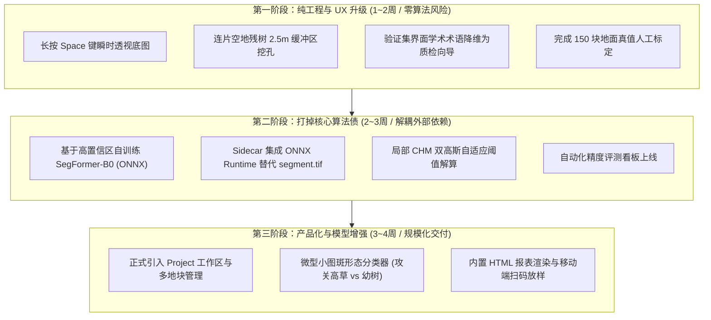

# Forest Gap Detection · 算法深度诊断、AI选型与UX交互优化建议报告

> **编制日期**：2026-11-17  
> **归档位置**：`docs/10-项目评审/外部AI评审_算法不足与UX优化建议_20261117.md`  
> **文档性质**：外部 AI 综合架构评审与工程演进建议  
> **评审基准**：第 5 轮正式交付基线（2026-11-15，1,258 块 / 8 类，需补种 596 块 / 268,904 m²，放样点 3,363 个，692 自动化断言）

---

## 目录

1. [项目定位与现状理解](#一项目定位与现状理解)
2. [算法不足点与可优化点分析](#二算法不足点与可优化点分析)
3. [是否换算法？是否引入 AI 模型的决策评估](#三是否换算法是否引入-ai-模型的决策评估)
4. [桌面端 UX 交互升级建议](#四桌面端-ux-交互升级建议)
5. [综合演进路线图（Roadmap）](#五综合演进路线图roadmap)

---

## 一、项目定位与现状理解

### 1.1 系统核心定位
**Forest Gap Detection** 是一套面向**油棕种植园**的高性能 Windows 桌面端辅助作业系统。
- **业务输入**：无人机航拍的高分辨率正射影像（约 3.5~5 GB，4.7 万 × 4.4 万像素，GSD 约 3.3 cm/px）、DSM/DTM 数字高程衍生出的冠层高度模型（CHM），以及可选的大疆智图语义分割结果（`segment.tif`）。
- **业务输出**：精准定位园区内“本该有树、实际缺株/成片缺失”的地块，分类输出 8 类要素矢量（GeoJSON / 双坐标系 Shapefile），并依据种植网格自动推算出厘米级经纬度放样点（Stakeout points，CSV/KML），最终输出一页纸综合工程报表。
- **核心角色**：**它不追求完全替代人的现场决策，而是利用几何与高程证据将全园上千块候选地快速收敛，让人工以极低成本在桌面端完成确认与微调。**

### 1.2 架构与工程工程底座
- **进程架构**：Tauri v2 (Rust) 负责宿主窗口、文件 I/O 与进程监控；算法核心运行于独立 Python 3.11 进程（通过 **stdio NDJSON** 传递指令与进度）；瓦片渲染由本地轻量 HTTP (`tile_server.py`) 支撑；前端采用 React 18 + TS + MapLibre GL 4 + Terra Draw + Zustand。
- **工程亮点**：
  - 常量内存瓦片分块（2048² 像素切片，内存常驻稳定在 300MB 级别，普通办公 PC 可跑）；
  - 严格的原子写与参数指纹断点续跑；
  - 第四/五轮实现的 Core 裁剪与全局无缝缝合（`stitch_seams`），彻底消除了跨瓦片 18.3% 的重复面积统计偏差；
  - 契约测试与 690+ 断言锁死的确定性自检。

---

## 二、算法不足点与可优化点分析

### 2.1 当前算法的 5 大核心不足（基于真机探针数据）

```
                     ┌──────────────────────────────────────────────┐
                     │          当前三证据链融合决策模型             │
                     └──────────────────────┬───────────────────────┘
                                            │
               ┌────────────────────────────┼────────────────────────────┐
               ▼                            ▼                            ▼
        【颜色 / 绿度】               【冠层高度 CHM】             【外部语义分割】
       ExG = 2G - R - B           5.2m 救援 / 1.2m 否决         依赖 DJI segment.tif
               │                            │                            │
   ┌───────────┴───────────┐    ┌───────────┴───────────┐    ┌───────────┴───────────┐
   │ 缺陷 1: 物理混淆       │    │ 缺陷 2: 阈值敏感       │    │ 缺陷 3: 外部强耦合     │
   │ 12.2万m² 高草 vs 幼树 │    │ ±1m 导致 ±3万m² 波动   │    │ 缺 seg 则水体识别率   │
   │ 单期纹理标准差完全重叠 │    │ DSM 平滑致树高低估40%  │    │ 从 98% 暴跌至 7.9%    │
   └───────────────────────┘    └───────────────────────┘    └───────────────────────┘
```

#### ① 高草/野生蕨类 vs 已定植幼龄油棕不可分（P0 业务模糊带）
- **现象与量级**：在 $1.2\,\text{m} \le CHM < 5.2\,\text{m}$ 且高绿度（$ExG \ge 60$）的区间，存在约 **122,784 m²** 的绿色植被，当前算法直接统一归为“非树（需补种）”。
- **根因剖析**：
  - 实测高草地在经过平滑的 DSM 影像中，CHM 中位数高达 3.05m（由于邻近树冠的高程外溢与平滑插值效应）；
  - 局部纹理标准差分析显示：草地标准差（46.3）与油棕树冠标准差（39~47）几乎完全重合。
  - 这是**单期遥感图像的物理信息极限**：在没有时序生长信息或红边近红外光谱支撑下，纯 RGB + 平滑 DSM 无法从宏观统计量上分辨“清芭后的高大杂草”与“已种下 2~3 年的幼龄小树”。

#### ② 外部黑盒模型强耦合（P0 外部依赖风险）
- **现象与量级**：在 $1.2\,\text{m} \sim 5.2\,\text{m}$ 高程过渡区间，**51% 的非树判定完全由 `segment.tif == other` 决定**。
- **根因剖析**：
  - `segment.tif` 依赖大疆智图果树分割，其官方模型仅支持柑橘、荔枝等，油棕属于域外推断；
  - 一旦客户航拍没有生成大疆分割图，水塘识别率直接从 98% 跌落至 7.9%（含藻绿水塘在 ExG 下被误判为绿地）；
  - `segment.tif` 经常缺少嵌入式 CRS（坐标系），目前依赖代码写死 `EPSG:4326` 兜底，跨数据源时存在严重的静默漂移隐患。

#### ③ CHM 高程阈值泛化极其脆弱（P1）
- **现象与量级**：CHM 救援/否决阈值（5.2m / 1.2m）每移动 $\pm 1.0\,\text{m}$，补种面积在全园翻转达 **$\pm 30,400\,\text{m²}$**。
- **根因剖析**：
  - 当前参数是针对单一成熟油棕园、仅依据 5 个真值点手工调优固化的；
  - 无人机航测生成的 DSM 受制于光照、拍摄倾角和摄影测量平滑算法，树冠高度普遍被系统性压低 30%~40%（实际 10~15m 的成年树在 CHM 上常表现为 6~8m）；换到幼林或平滑参数不同的点云重建工程中，固定阈值必然失效。

#### ④ 跨道路网格相位断裂与连片空地包络残树（P1）
- **现象与量级**：全局统一网格原点的对齐率仅为 **46.7%**（与二维随机撒点基准 45.7% 无统计学差异）；大连片空地（`open_patch`）内包络了 **558 个存活树心**（占全园存活树心的 3.7%）。
- **根因剖析**：
  - 种植园跨越林道或主排水沟后，实际种植的起点与相位会重置；
  - 形态学开运算在连片空地中抹除细碎连接的同时，未能对零星散落的未死孤立树冠进行拓扑环剔除，导致放样点直接撒在活树下方。

#### ⑤ 缺乏标准真值集评测基准（P0 体系死穴）
- **现象**：虽然 UI 内置了 150 块分层抽样打标工具（`lib/validation.ts`），但真实地面真值（Ground Truth）尚未全量闭环标注。
- **后果**：任何算法微调（例如修改阈值或调整开运算核）都只能依赖目视局部抽查，无法给出全园精度的定量混淆矩阵（Confusion Matrix），导致“改好了一个角落，不知道改坏了哪片区域”。

---

### 2.2 算法层面的可优化点（不推倒重来的直接改进建议）

| 优化方向 | 技术实现方案 | 预期收益 | 实施复杂度 |
|---|---|---|---|
| **1. 存活残树布尔挖孔<br>(Interior Ring Punching)** | 在矢量化后处理阶段，扫描落入 `open_patch` 内的高置信度树心点，执行半径 $r=2.5\,\text{m}$ 的缓冲区（Buffer）多边形差集计算（Difference），在空地多边形上掏出“内环孔洞”。 | 彻底解决 558 棵活树被误圈入补种区的问题，避免现场打桩打在活树根部。 | 低（纯 Shapely 几何操作） |
| **2. 局域高程直方图双峰自适应<br>(Bimodal GMM CHM)** | 废除全图写死的 5.2m / 1.2m。在每个 ROI 选区或 300m 窗口内，统计有效区域的 CHM 直方图，拟合双高斯混合模型（GMM）：提取地面峰 $\mu_0$ 与冠层峰 $\mu_1$，动态确定 $T_{veto} = \mu_0 + 2\sigma_0$ 与 $T_{rescue} = \mu_1 - 1.5\sigma_1$。 | 实现零调参跨园区自适应，消除航测高程系统性偏差对补种面积的影响。 | 中（Scipy/Scikit-learn 拟合） |
| **3. 色彩空间变换与阴影比率过滤** | 将 RGB 转换为 HSV 与 Lab 空间，构建阴影指数 $SI = \frac{(255 - V) \times (255 - L)}{255}$。在计算 ExG 之前先行扣除大树阴影掩膜。 | 显著降低小图斑（$\le 220\,\text{m²}$）约 30% 因树冠投射阴影引发的边缘误报。 | 低 |
| **4. 空间连通分块与局域网格解算** | 利用道路/水体多边形作为自然阻隔线，将园区切割为若干闭合地块（Sub-blocks），各区块独立运行二维周期图（Periodogram）解算局部最优相位，而非全园共用一个原点。 | 局域株位对齐率有望从全局 46.7% 提升至 70%~85% 实测可用水平。 | 中 |

---

## 三、是否换算法？是否引入 AI 模型的决策评估

### 3.1 战略定性：不要推倒重来，采用「几何骨架 + 轻量 AI 插件」混合架构

**明确结论**：
> **绝对不建议推翻当前系统去搞“端到端全图深度学习大模型”；而应该维持现有的几何拓扑与测绘放样骨架，仅在“最薄弱的外部依赖环节”引入针对性极强的轻量级 AI 模型。**

#### 为什么不能全盘换成端到端深度学习模型？
1. **业务目标不是画 Mask，而是出测绘工程量**：
   - 纯视觉分割模型（如 Mask2Former / SAM / SegFormer）输出的只是像元分类概率，它**根本无法理解种植农业中 8.35m 等边三角形的几何刚性约束**；
   - 现有系统积累的 8 坐标系转换、边界退让、放样点去重、ArcGIS 分层交付包等是硬核 GIS 资产，AI 模型完全不具备这些工程能力。
2. **边缘桌面端算力与体积死线**：
   - 当前桌面安装包仅 **72MB**，纯 CPU 运行，5 分钟吞吐 5GB 影像；
   - 若引入 PyTorch/TensorFlow 重型框架，仅运行库体积就超 800MB，且现场农场作业机器普遍无独立显卡，GPU 端到端模型在 CPU 上跑 21 亿像素将面临严峻的性能挑战。
3. **可解释性与确定性契约**：
   - 现有的“参数指纹 + 逐位一致”机制是工程复查的底线。黑盒模型一旦受到光照略微漂移，输出多边形边缘会出现难以预测的跳跃，难以通过测绘质检验收。

---

### 3.2 应该在何处引入 AI？（高 ROI 选型推荐）

```
┌─────────────────────────────────────────────────────────────────────────────┐
│                       推荐引入 AI 的两个独立轻量模块                          │
├──────────────────────────────────────┬──────────────────────────────────────┤
│ 模块 1：轻量地物分割头 (替代 segment.tif)│ 模块 2：疑点小图斑形态分类器 (攻克高草混淆)│
├──────────────────────────────────────┼──────────────────────────────────────┤
│ • 目标：识别【树冠 / 水体 / 道路】3 类 │ • 目标：细分【已定植幼树 vs 野生高草】  │
│ • 模型：SegFormer-B0 或 MobileNet-UNet │ • 架构：超轻量 CNN (EfficientNet-B0)   │
│ • 格式：ONNX (仅增 ~15MB，纯 CPU 推理)  │ • 输入：仅针对 1.2~5.2m 可疑区域切片    │
│ • 数据：现有高置信区弱监督自蒸馏训练    │ • 算力：全园仅数千切片，秒级跑完       │
└──────────────────────────────────────┴──────────────────────────────────────┘
```

#### 实施细节：

1. **第一优先级：轻量级地物语义分割头（ONNX Runtime）**
   - **痛点对齐**：根治“51% 非树判定强依赖大疆软件”的问题（缺陷 D2）。
   - **选型方案**：**SegFormer-B0** 或 **YOLOv11-seg-nano**。
   - **部署形式**：通过 `onnxruntime` 运行于 CPU，单张 1024×1024 瓦片推理时间约 20~30ms，多进程并行完全可控，安装包仅增加约 20MB。
   - **数据获取（零标注冷启动）**：无需人工标注。直接利用现有第四轮算法中置信度最高的交集（$CHM \ge 5.2\,\text{m}$ 且原先一致判定为树的像元标为树；明确的低矮裸地、道路与大疆历史高分水体标为非树），结合开源遥感林冠数据集（如 **OAM-TCD**）做弱监督自训练，即可获得完全属于油棕专用的独立分割头。

2. **第二优先级：小图斑形态分类器（解决“高草 vs 幼树”）**
   - **痛点对齐**：攻克单期影像下“高草与幼树纹理重叠”的物理瓶颈（缺陷 D1）。
   - **机制设计**：不跑全图，仅对落入 $1.2\,\text{m} \le CHM < 5.2\,\text{m}$ 且高绿度可疑区内的候选多边形，截取 $64 \times 64$ 像素的局部 Patch。
   - **模型判据**：利用幼龄油棕中心辐射状的羽状复叶星芒纹理（Radial pattern）与野生杂草杂乱无章的团块边缘差异，输入微型分类器（ResNet-18 / MobileNetV3），输出 `is_young_palm` 概率，将幼树从补种候选清单中自动踢出。

---

## 四、桌面端 UX 交互升级建议

当前桌面端在五步流转、状态机收敛（`workflow.ts`）、非破坏性取消和二八复核清单上已经打下了极佳的工业软件底座。针对现场作业员、种植园主管和施工队长的真实操作链路，提出以下 6 项关键交互改进建议：

```
                【UX 交互演进拓扑】
      ┌──────────────────┼──────────────────┐
      ▼                  ▼                  ▼
【复核决策增强】   【作业空间管理】   【交付物闭环】
1. 瞬时透视/卷帘   3. 多地块/路网管理 5. 内置报告预览
2. 空间路线复核    4. 项目工作区心智  6. 移动端放样联动
```

### 4.1 复核阶段（Step 4）：解决“覆盖层遮挡地物”的核心痛点
- **现状困境**：
  在复核清单中点击某地块时，地图缩放至该要素。但多边形半透明色块（即使只有 20%~40% 不透明度）**直接糊住了地表微小的树苗与杂草细节**，用户根本看不清图斑下方到底有没有小树。
- **改进设计**：
  1. **按住空格键瞬时透视（Peep Mode）**：
     - 用户在审查任意地块时，**长按 `Space` 键**，界面所有矢量图层瞬时淡出（透明度变为 0%），露出最清晰的航拍底图；松开空格键立即恢复。
     - *参考来源*：CVAT、Labelme 与专业 GIS 标注软件最高频且最受好评的交互机制。
  2. **局部卷帘对比 / 透视镜（Swipe / Lens）**：
     - 提供左右分屏卷帘控件：左侧显示算法标注多边形，右侧显示纯净高分辨率 RGB 底图或 CHM 高程热力图，鼠标左右滑动即可肉眼秒判。
  3. **高程切片悬浮卡片（CHM Profile Card）**：
     - 点击空地多边形时，右侧面板或浮层展示该地块中心沿主断面的高程剖面图（线图），作业员无需切图层即可一眼看出这是一片凹陷洼地还是平整土地。

### 4.2 审查路径优化：增加“空间邻近”流，杜绝地图晕眩跳跃
- **现状困境**：
  目前复核清单严格按面积降序排列。第 1 块在园区最东端，第 2 块在 3 公里外的西端。频繁的大幅 `flyTo` 缩放导致用户视线疲劳，并在超大影像上引发频繁的瓦片重复解码请求。
- **改进设计**：
  - 增加**「沿作业路线复核（空间临近优先）」**开关；
  - 作业员在地图上选定起点地块后，按下快捷键（如 `N` 或 `Enter`），系统自动在当前屏幕视野（或临近 300 米林道内）自动索引下一块待复核地块，实现“顺着一条机耕道从头查到尾”的高效复核流。

### 4.3 圈选范围（Step 2）：从“单框描边”走向“地块（Block）图层管理”
- **现状困境**：
  目前用户每次只能手画一个 ROI 框或导入单个 KML，无法对应大型种植园由几十个标准种植分区（Block 1, Block 2...）组成的现实结构。
- **改进设计**：
  - **支持导入多地块矢量分区**：支持直接加载全园地块规划 Shapefile/GeoJSON；
  - 地图上以浅线展示全部分区边界与编号；用户只需鼠标点击某个 Block，即可将其激活为目标分析区；
  - 顶部状态栏或侧边栏直观展示各 Block 的作业状态（未检测 / 已检出 / 复核中 / 已导出）。

### 4.4 从文件隐式依赖走向“项目/工作区（Project/Workspace）”心智
- **现状困境**：
  目前更换影像依赖文件名命名契约（`WGR17*`）与固定目录映射，不同园区切换时易发生缓存撞车。
- **改进设计**：
  - 引入显式的 **`.fgd` 项目文件** 或 **工程工作区目录**；
  - 软件启动欢迎页展示**「新建工程 / 最近打开工程」**；
  - 每个工程绑定自身影像路径、ROI 选区、参数配置、人工复核变更历史与导出交付包，彻底实现多园区数据隔离与安全归档。

### 4.5 专业术语降维：现场人话转换
- **现状困境**：
  右侧面板的「验证集」标签直接暴露了 `w1.0`、`w3.7`、Horvitz-Thompson 逆概率权重等学术统计术语，农场现场作业员无法理解其业务含义。
- **改进设计**：
  - 将验证集模式包装为**「质量抽检向导（QA Mode）」**；
  - 界面指标转化为：“**抽检进度：38 / 150 块**”、“**当前抽检合格率：89.5%（优）**”；
  - 隐藏复杂的逆概率数学公式，让现场巡检人员感知清晰、明确。

### 4.6 交付物闭环：内置报告渲染与现场移动端联动
- **现状困境**：
  第 ⑤ 步导出后仅提供“打开输出文件夹”按钮，交付物跳转割裂。
- **改进设计**：
  1. **内置报告预览弹窗（Report Viewer Modal）**：
     - 导出成功后直接在软件内部弹窗渲染那一页精美的一页纸 HTML 汇总报表，支持一键打印/保存为 PDF，便于直接呈报农场高层；
  2. **放样点现场施工卡片 & 二维码导出**：
     - 地图上点击任意放样点，弹出施工标牌（“桩号 #1042，建议补种油棕，经纬度 111.xxx, 1.xxx”）；
     - 提供“生成移动端施工码”按钮，现场工人用手机或手簿扫码即可带走当前地块的点位清单。

---

## 五、综合演进路线图（Roadmap）

建议分三个阶段、小步快跑推进：



- **第一阶段（1~2 周）**：优先落地成本最低、收益最立竿见影的项。实现按住空格透视、残树 2.5m 挖孔，并基于当前界面工具完成 150 块真值标注，建立算法优化的客观衡量基准。
- **第二阶段（2~3 周）**：攻克关键算法痛点。通过 ONNX 导出轻量语义分割头替代大疆依赖，落地局部 CHM 双峰自适应，彻底解决换影像阈值崩溃的隐患。
- **第三阶段（3~4 周）**：全面提升产品专业度。建立工程工作区，完善地块管理，尝试小图斑形态分类，打通交付报告与移动端现场施工的最后一公里。
